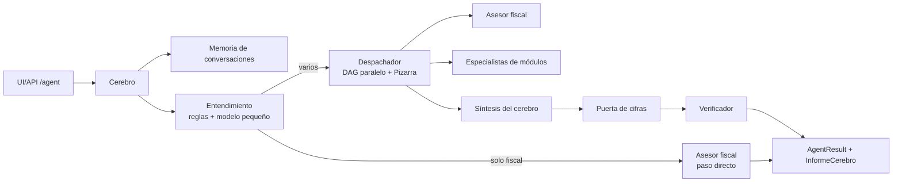

# ADR 0003: Cerebro del hogar — un generalista que entiende, consulta a especialistas y responde con cifras trazables

- **Estado**: Aprobado (en producción con `CEREBRO_MODO=hogar`; el modo `fiscal` se mantiene como legado)
- **Fecha**: 2026-11-18
- **Decisores**: Plataforma del asistente
- **Ámbito**: Orquestación de la conversación (`asistente/nucleo/cerebro`), API `/agent`, interfaz del chat

## 1) Contexto

El asistente nació como asesor fiscal (ADR 0001) y fue sumando módulos del hogar (luz, hipoteca, ayudas,
suscripciones, caducidades, correo, navegador). Cada módulo entraba como una herramienta `consultar_<clave>` del
asesor fiscal: su prompt empezaba por «Eres un asesor fiscal…», todas las preguntas (un saludo incluido) pasaban por
el bucle fiscal, las preguntas que cruzaban ámbitos se resolvían en serie dentro de una sola ventana de contexto y
nada comprobaba que la respuesta final no sumara cifras de dos módulos que ninguna calculadora había combinado.

## 2) Problemas

1. **Identidad equivocada**: el asistente del hogar hablaba como asesor fiscal y gastaba un bucle fiscal completo en
   preguntas que no lo eran.
2. **Sin entendimiento explícito**: qué especialistas intervenían lo decidía el modelo grande sobre la marcha; no
   había plan, ni dependencias, ni una pregunta aclaratoria cuando la petición era ambigua.
3. **Serie, no paralelo**: dos especialistas independientes se consultaban uno detrás de otro.
4. **Cifras sin control en la síntesis**: el verificador comprobaba afirmaciones citadas, pero una suma de cifras de
   dos especialistas («en total ahorras 2.350 €») o una cifra atribuida al especialista equivocado pasaban.
5. **Sin memoria de conversaciones** ni forma de preguntar a otro especialista por un dato.

## 3) Decisión: un cerebro generalista con especialistas, puertas deterministas y modo legado

- **Cerebro** (`Cerebro.run`, misma firma que el asesor más `conversacion_id`, mismo `AgentResult` más
  `cerebro: InformeCerebro`): memoria → entendimiento → vías rápidas → colaboración → síntesis → puertas.
- **Entendimiento híbrido**: reglas deterministas y explicables primero (vocabulario curado por especialista,
  términos derivados de cada módulo, hechos del expediente, referencias al pasado, charla, acciones, seguimientos);
  el modelo pequeño (`cerebro:intencion`) solo cuando las reglas dudan, con su JSON validado y reparado; por debajo
  del umbral, una única pregunta aclaratoria.
- **El asesor fiscal es un especialista** (`EspecialistaFiscal`) con su rigor intacto: el mismo bucle, citas del BOE,
  verificador, crítico y equipo, propuestas de los módulos; sin las herramientas del hogar (las coordina el cerebro).
  Cuando la pregunta es solo fiscal, su respuesta verificada **es** la respuesta (paso directo, sin llamadas extra).
- **Colaboración en paralelo** (paquete `colaboracion`): los encargos como un DAG, con un tablero (`Pizarra`) por el
  que un especialista pide un dato a otro a través del cerebro, con profundidad y número acotados.
- **Puertas**: la de cifras (determinista: cada número de la respuesta sale de una herramienta de un especialista o
  de las palabras del usuario; ninguna suma no combinada; atribución correcta) y el verificador de siempre sobre las
  afirmaciones citadas. Revisiones acotadas; si persiste el fallo, la cifra se retira con aviso o se muestran los
  informes por separado: nunca una cifra equivocada con seguridad. El modo final nunca es mejor que el del peor
  especialista.
- **Modo legado**: `CEREBRO_MODO=fiscal` sirve el asesor único exactamente como antes; sus pruebas siguen.

## 4) Alternativas descartadas

- **Mantener el asesor fiscal como orquestador** con un prompt «del hogar»: no resuelve el paralelo ni el control de
  cifras, y diluye el prompt fiscal que el registro de prompts tiene versionado y evaluado.
- **Router solo con modelo** (cada turno una llamada de clasificación): coste y latencia en el caso más común (una
  pregunta de un solo ámbito) y resultados no deterministas en las pruebas guionizadas.
- **Router solo con reglas**: incapaz de escribir subpreguntas autosuficientes y dependencias en una pregunta cruzada.
- **Comprobar las cifras pidiéndoselo al prompt**: una promesa del prompt no es una puerta; el control es código.

## 5) Trade-offs

- **Más piezas** (entendimiento, despachador, puerta) a cambio de un control explícito y trazable de cada cifra.
- **Una llamada pequeña extra** en las preguntas cruzadas o ambiguas; ninguna en las de un solo ámbito claro.
- **Síntesis**: un paso más (y a veces una verificación) en las preguntas de módulos; a cambio, una sola voz, cifras
  atribuidas y la posibilidad de volver a consultar.
- El vocabulario curado hay que mantenerlo al añadir un módulo; mientras tanto el módulo aporta su propio
  vocabulario derivado (nombre, descripción, etiquetas de sus hechos).

## 6) Riesgos y mitigaciones

| Riesgo | Mitigación |
|---|---|
| Mala ruta en una petición ambigua | Umbral de confianza → pregunta aclaratoria; plan visible en vivo y «Consulté a…»; replanificación en la síntesis. |
| Inyección desde informes, correo o memoria | Todo llega como DATOS neutralizados (`neutralizar_inyeccion`); el encargo nunca pasa por «palabras del usuario». |
| Coste descontrolado | Llamadas medidas por propósito, presupuesto por pregunta, réplicas y revisiones acotadas, paralelismo limitado. |
| Una pieza opcional falla (memoria, modelo de intención) | Se degrada a reglas, a memoria vacía, al despacho secuencial; el turno nunca falla por ella. |
| Regresión del asesor fiscal | Paso directo idéntico; ganchos de `TaxAgent` con valores por defecto del comportamiento anterior; modo legado probado. |

## 7) Plan incremental de migración (sin detener funcionalidad actual)

1. Contrato compartido (`cerebro/contrato.py`) y ganchos del asesor con valores por defecto neutros.
2. Entendimiento, especialista fiscal, cerebro y API (`conversacion_id`, informe del cerebro) con `CEREBRO_MODO`.
3. Colaboración en paralelo, puerta de cifras y memoria de conversaciones.
4. Interfaz: plan en vivo, «Consulté a…», «¿De dónde sale cada cifra?».
5. Evaluación: el informe del cerebro entra en los casos capturados; un cambio de prompt o modelo solo se acepta si no
   empeora la evaluación.
6. `CEREBRO_MODO=fiscal` queda como salida de emergencia mientras la evaluación del cerebro madura.

Detalle técnico: [docs/cerebro/arquitectura.md](../cerebro/arquitectura.md).
