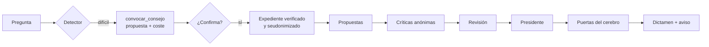

# ADR 0004: Consejo del hogar — varias IA independientes, críticas anónimas y un dictamen con consenso y disenso

- **Estado**: Aprobado (activo con `CONSEJO_ACTIVO=true`; se mantiene solo si la evaluación muestra que no es peor que
  el cerebro solo en los casos de decisión)
- **Fecha**: 2026-11-18
- **Decisores**: Plataforma del asistente
- **Ámbito**: `asistente/nucleo/consejo`, la herramienta `convocar_consejo` del cerebro, API `/cases/{id}/consejo`,
  tarea `consejo`, interfaz del chat y panel «Consejo»

## 1) Contexto

El cerebro del hogar (ADR 0003) responde bien a preguntas de datos y de cálculo: especialistas con calculadoras,
citas comprobadas y una puerta de cifras. Pero hay decisiones difíciles —amortizar o invertir, aceptar o renunciar a
una herencia, comprar o seguir de alquiler, recurrir una liquidación— en las que no hay una cifra que zanje la
cuestión: hay compromisos entre riesgo, liquidez, impuestos y preferencias, consecuencias difíciles de deshacer e
incertidumbre. Una sola respuesta de un solo modelo, con la inclinación del usuario a la vista, tiende a darle la
razón y a ocultar el desacuerdo razonable.

## 2) Problemas

1. **Un solo punto de vista**: un modelo, un razonamiento; los ángulos que no ve no aparecen.
2. **Sesgos conocidos de los modelos**: complacencia con el usuario, preferencia por la primera opción leída, por las
   respuestas largas o por las suyas propias.
3. **El desacuerdo se pierde**: la respuesta única no dice cuándo hay razones serias para lo contrario.
4. **Coste**: varias IA cuestan varias veces más; no puede ocurrir sin que el usuario lo decida.
5. **Privacidad**: enviar el expediente completo a varios proveedores de modelos multiplica la exposición.

## 3) Decisión

- **Solo para decisiones difíciles**: un detector determinista y explicable (alternativas, irreversibilidad, importes
  grandes, varios ámbitos, duda declarada; nunca para preguntas informativas) decide si el cerebro puede ofrecerlo;
  o el usuario lo pide («consúltalo con el consejo»).
- **Siempre con confirmación y coste**: la herramienta del cerebro no ejecuta nada; crea una propuesta con su coste y
  tiempo estimados que el usuario confirma o rechaza en una tarjeta. Tope duro (estimación × factor, con un máximo
  absoluto): al llegar, la sesión para y lo dice.
- **Fase 0, el expediente**: los especialistas del cerebro calculan las cifras de cada opción (con su procedencia);
  la pregunta se reformula en neutro con opciones excluyentes comprobadas por código; perfil mínimo seudonimizado;
  la preferencia del usuario, SELLADA hasta la ronda de revisión. El consejo nunca calcula ni interpreta la ley.
- **Deliberación** (motor del agente F): propuestas independientes en paralelo → críticas anónimas (etiquetas, orden
  por revisor, sin la propia, rúbrica fija) → revisión → síntesis del presidente con agregación robusta, medida del
  acuerdo, consenso Y disenso con el argumento de la minoría, supuestos decisivos, sensibilidad y el dato que lo
  aclararía. Familias de modelos distintas cuando están configuradas.
- **Puertas del cerebro** sobre el dictamen: la de cifras contra el expediente y el verificador sobre lo que cite.
- **En segundo plano**: tarea `consejo` con arriendos (una sesión en marcha por caso) y arranque inmediato en un hilo
  en despliegues de un solo proceso; llega como UN aviso «Dictamen del consejo listo» (gravedad `info`).
- **Transparencia**: la autoría se revela solo en el dictamen; el usuario ve qué se anonimizó y cuánto costó.

## 4) Alternativas descartadas

- **Un solo modelo «pensando más»**: no corrige los sesgos de un punto de vista único ni muestra desacuerdo.
- **Debate abierto entre modelos** (se leen con nombre y se responden): ancla en el primero que habla y en el que
  parece más autorizado; las críticas anónimas con rúbrica fija lo evitan.
- **Votación simple**: un revisor ruidoso puede decidir; la agregación robusta y la medida del acuerdo no.
- **Ejecutarlo siempre en preguntas «importantes»** (sin confirmar): coste sin consentimiento.
- **Detectar decisiones difíciles con un modelo**: una llamada por turno para decidir si se ofrece algo opcional; las
  reglas son baratas, deterministas y explicables, y el usuario confirma de todas formas.
- **Enviar el expediente completo**: los miembros no necesitan el nombre, el sexo ni el origen para comparar opciones;
  quitarlos protege la privacidad y elimina sesgos (comprobado con pruebas contrafactuales).

## 5) Trade-offs

- **Coste y tiempo**: unas decenas de llamadas y algunos minutos por sesión; mitigado con el detector, la
  confirmación, el tope y el enrutado por niveles (`consejo:expediente` pequeño, miembros medianos, presidente grande).
- **Más piezas** (detector, expediente, seudonimización, almacén con arriendos, motor) a cambio de un proceso auditable.
- **La seudonimización por reglas** puede dejar pasar un nombre poco común escrito suelto; se compensa con no enviar
  nunca la pregunta original a los miembros sino la neutral, y con la lista de lo anonimizado a la vista.

## 6) Riesgos y mitigaciones

| Riesgo | Mitigación |
|---|---|
| Gasto no deseado | Nada sin confirmar; tope duro comprobado antes de cada llamada; límites diarios de la app; cancelación inmediata. |
| Cifras inventadas en el dictamen | El consejo solo usa cifras del expediente; puerta de cifras del cerebro; las que no salen de un cálculo se retiran y se dice. |
| Complacencia con el usuario | Preferencia sellada en la primera ronda; pregunta neutral comprobada; abogado del diablo en el consejo. |
| Sesgos de posición, autoría, estilo | Anonimato, orden por revisor, mismo esquema, topes de longitud, sin autoevaluación, rúbrica fija; arnés de sesgos (agente H). |
| Fuga de datos personales | Perfil mínimo por lista blanca, textos seudonimizados, inyección neutralizada; exportación y borrado con el caso y la cuenta; retención. |
| Un trabajador se cae a mitad | Arriendo que caduca y otro retoma (`CONSEJO_MAX_INTENTOS`); después, fallida con aviso. |
| Carreras (doble confirmación, dos trabajadores) | Transiciones condicionales atómicas; reclamo en `BEGIN IMMEDIATE`; una sesión en marcha por caso. |
| El consejo no mejora al cerebro solo | Solo se mantiene si la evaluación (puerta de promoción) muestra que no es peor en los casos de decisión. |

## 7) Plan incremental

1. Contrato compartido (`consejo/contrato.py`).
2. En paralelo: motor de deliberación (F), integración / expediente / privacidad / producto (G), evaluación y arnés de
   sesgos (H).
3. Integración: herramienta del cerebro y tarjeta en el chat, API, tarea, aviso, exportación y borrado.
4. Evaluación en los casos de decisión y de sesgo; el consejo se ofrece por defecto solo si pasa la puerta.

Detalle técnico: [docs/consejo/arquitectura.md](../consejo/arquitectura.md).
