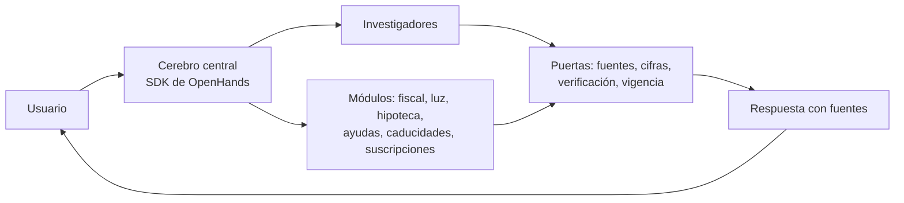

# ADR 0005: Reenfoque del producto — cerebro personal fiable, Hacienda como primer módulo y orquestación con el SDK de OpenHands

- **Estado**: Aprobado (Fase 0: documentación; la migración del código va en fases posteriores)
- **Fecha**: 2026-11-22
- **Decisores**: Plataforma del asistente
- **Ámbito**: identidad del producto, `README.md`, `docs/`; orquestación de `asistente/nucleo/` y de los
  investigadores (implementación en curso en otras ramas)

## 1) Contexto

El proyecto empezó como «HaciendaGPT», un asistente RAG sobre la AEAT. Con el tiempo creció un cerebro del hogar
([ADR 0003](0003-cerebro-del-hogar.md)) con especialistas (luz, hipoteca, ayudas, caducidades, suscripciones), un
[consejo](0004-consejo.md) para decisiones difíciles y capacidades compartidas (correo, navegador, documentos,
investigación). El nombre y la documentación seguían presentando un asesor fiscal con extras, lo que ya no describe
el sistema ni su propuesta de valor.

A la vez, la orquestación de agentes (bucle de herramientas, encargos en paralelo, delegación, reintentos, estado de
conversación) se mantiene con código propio, y el plan de un **ejército de investigadores** multiplica esa carga.

## 2) Decisión

1. **El producto es un cerebro personal fiable**: un cerebro central que orquesta agentes investigadores y módulos
   especializados. Su propuesta de valor es investigar a fondo con **cada afirmación con fuente y cada cifra
   verificada**.
2. **Hacienda es el primer módulo**, no el producto. Conserva su rigor (citas del BOE, verificador, puerta de cifras,
   vigencia) y sirve de listón para los demás módulos.
3. **Garantías de fiabilidad no negociables**, aplicadas en código: fuentes obligatorias (abstención si faltan),
   puerta de cifras, verificación cruzada, vigencia de las fuentes, confirmación humana para todo lo que actúe,
   privacidad (datos mínimos y seudonimizados, consentimiento por capacidad) y defensa ante *prompt injection*
   (el contenido de terceros es dato, nunca instrucción).
4. **Orquestación con el SDK de OpenHands** (OpenHands Software Agent SDK) en lugar de mantener un bucle propio: el
   SDK aporta el ciclo agente–herramientas, la delegación en subagentes, el estado y la persistencia de
   conversaciones y la ejecución aislada. Las garantías del punto 3 siguen siendo nuestras: se implementan como
   herramientas, comprobaciones y puertas alrededor del SDK, no se delegan en él.
5. **Nombre de producto propuesto: «Criterio»** — corto, en español y centrado en lo que se vende: juicio
   respaldado por pruebas. Es solo una propuesta: **no se renombran paquetes** (`asistente/`, alias `hacienda_gpt`)
   ni rutas, órdenes o variables de entorno en esta decisión.

## 3) Alternativas descartadas

- **Seguir con el bucle propio**: control total, pero cada capacidad nueva de orquestación (delegación, paralelismo,
  persistencia, aislamiento) es código que mantener y probar; no escala al ejército investigador.
- **LangGraph**: grafo de estados potente, pero obliga a modelar el flujo como grafo explícito y arrastra el
  ecosistema LangChain; el cerebro necesita delegación dinámica más que un grafo fijo, y añade una abstracción más
  sobre las puertas que ya tenemos.
- **Claude Agent SDK**: muy capaz, pero ligado a un proveedor de modelos; el proyecto exige poder usar Claude,
  OpenAI o modelos locales (y familias distintas en el consejo), y el SDK de OpenHands es agnóstico al proveedor.
- **Mantener «HaciendaGPT» como marca**: describe solo un módulo y limita la visión.

## 4) Consecuencias

- La documentación empieza por la visión del cerebro personal; lo fiscal se documenta como módulo.
- La migración a OpenHands se hará por fases, manteniendo las evaluaciones actuales como red: ningún cambio se
  acepta si empeora la evaluación continua.
- Dependencia nueva de un SDK externo: se fija versión y se encapsula tras una interfaz propia para poder cambiarlo.
- El renombrado de paquetes, si llega, será una decisión aparte con su periodo de compatibilidad.
