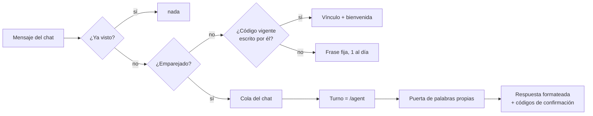

# ADR 0005: Mensajería — hablar con el cerebro del hogar desde SimpleX, con una pasarela independiente del canal

- **Estado**: Aprobado (activo con `MENSAJERIA_ACTIVA=true`; desactivado por defecto)
- **Fecha**: 2026-11-19
- **Decisores**: Plataforma del asistente
- **Ámbito**: `asistente/plataforma/mensajeria` (pasarela y adaptadores), API `/mensajeria/*`, servicio del worker
  `mensajeria`, panel «Mensajería»

## 1) Contexto

El usuario quiere «conectarme al cerebro central desde SimpleX para preguntarle cosas». Hasta ahora el cerebro del
hogar (ADR 0003) solo se alcanzaba desde la web: la sesión del navegador decide quién pregunta, el historial vive en el
navegador y las confirmaciones son botones. Una app de mensajería cambia las tres cosas: cualquiera puede escribir a
la dirección del bot, el canal entrega mensajes reenviados y citas, y no hay botones.

## 2) Problemas

1. **Identidad**: la dirección del bot es pública (es un QR); recibir un mensaje no dice de quién es.
2. **Coste y privacidad ante desconocidos**: cada mensaje que llegara al cerebro costaría dinero y podría filtrar datos.
3. **Palabras ajenas**: un mensaje reenviado (una factura, un correo) no son palabras del usuario; el cerebro y su
   memoria no deben tomarlo como tal (ni registrar hechos ni recordarlo como «me dijiste»).
4. **Confirmaciones**: un «sí» en un chat es ambiguo; una acción que actúa fuera de la app o gasta necesita una
   confirmación inequívoca de ESE elemento.
5. **Dos procesos**: el canal vive en el worker (una conexión larga), la app en la API: el código de emparejamiento, la
   dirección del bot y la desvinculación cruzan de uno a otro.
6. **Más canales después** (Signal, Telegram): la lógica no debe duplicarse por canal.

## 3) Decisión

- **Pasarela independiente del canal + adaptadores mínimos** (`contrato.py`): el adaptador solo mueve mensajes; la
  pasarela decide quién habla, ejecuta el turno, confirma, entrega avisos y aplica límites. SimpleX primero (cifrado de
  extremo a extremo, sin teléfono ni identificador de usuario).
- **Emparejamiento con un código de un solo uso** generado en la app (60 bits, 10 minutos, guardado como hash, ligado a
  usuario y expediente) y escrito en el chat; límites de intentos por contacto y globales. Un contacto no emparejado
  recibe UNA frase fija al día y nada más: sin cerebro, sin coste, sin datos.
- **El turno es el de `/agent`**, por el mismo código (`api.ejecutar_turno_agente`, añadido junto a `/agent` sin
  cambiarlo): módulos del usuario, presupuesto por usuario, auditoría, acciones pendientes y memoria
  (`registrar_turno`), con `user_id` el dueño emparejado. En un hilo con `contextvars.copy_context`.
- **Lo reenviado o citado son datos**: van como bloque citado (la forma que la memoria ya excluye de las palabras del
  usuario), con el cebo de inyección neutralizado, y una puerta propia (`PuertaPalabrasPropias`) vuelve a comprobar con
  la función del núcleo (`procedencia.sin_respaldo`) cada hecho escrito en el turno contra las palabras PROPIAS del
  usuario: si alguno solo sale del texto ajeno, no se guarda ningún cambio del turno y la respuesta lo dice.
- **Confirmar en el chat solo con código**: un código de un solo uso por elemento, ligado al chat, que caduca; un
  «sí» o un mensaje reenviado no confirman nada; lo confirmado pasa por la misma puerta que el botón de la app.
  `MENSAJERIA_CONFIRMAR_EN_CHAT` decide qué clases se pueden confirmar en el chat.
- **La base de datos como frontera entre procesos**: el worker publica el estado del canal (dirección del bot); la API
  encola las desvinculaciones; disparadores de borrado con el caso y con la cuenta que también encolan la eliminación
  del contacto en el canal.
- **Lo mínimo guardado**: ningún texto de mensaje propio de la pasarela (el turno se audita y se recuerda como en
  `/agent`); el historial reciente del chat solo en memoria (RAM); códigos y mensajes procesados solo como hash.

## 4) Alternativas descartadas

- **Emparejar por el nombre o el número del contacto**: SimpleX no tiene identificadores estables de persona; y un
  nombre se elige libremente. Sin secreto no hay prueba de identidad.
- **Confirmar con «sí»/«no»**: ambiguo en un chat (¿a qué responde?), y un mensaje reenviado podría decirlo.
- **Que el adaptador llame al cerebro**: cada canal duplicaría las puertas; un fallo en uno abriría el acceso.
- **Guardar el historial del chat en el servidor**: más datos personales sin necesidad; el registro del servidor ya es
  la auditoría y la memoria, como en la web.
- **Cambiar ahora el filtro de procedencia del núcleo para ignorar lo citado**: es la solución de fondo, pero toca la
  puerta de todos los turnos de la web; se propone aparte. Mientras tanto, la puerta de la pasarela aplica la misma
  función solo a las palabras propias.

## 5) Trade-offs

- La puerta de palabras propias es conservadora: si un hecho del turno sale de texto reenviado, se descartan TODOS los
  cambios del caso de ese turno (sin fusiones parciales); el usuario repite el dato con sus palabras.
- Un mensaje reprocesado nunca se repite (como mucho una vez): si el proceso cae a mitad de un turno, ese mensaje no se
  reintenta; el usuario vuelve a preguntar.
- El historial en RAM se pierde al reiniciar el worker: la conversación sigue con la memoria del cerebro.
- Los avisos en pausa no se reenvían al reanudar: están en la app.

## 6) Riesgos y mitigaciones

- **Robo del teléfono emparejado**: desvincular desde la app (efecto inmediato en la pasarela); las acciones siguen
  exigiendo código por elemento; `MENSAJERIA_CONFIRMAR_EN_CHAT` permite dejarlas solo para la app.
- **Fuerza bruta del código**: 60 bits, 10 minutos, límites por contacto y globales; pasado el límite no se comprueba.
- **Inyección en texto reenviado**: bloque citado, neutralizado, y nunca un comando.
- **Coste**: nada llega al cerebro sin emparejar; ritmo por chat; presupuesto diario del usuario comprobado antes.
- **Fugas en el canal**: avisos con el mínimo texto; los adjuntos se borran siempre; los fallos no muestran detalles.

## 7) Plan incremental

1. Pasarela, emparejamiento, conversación, comandos, confirmaciones, avisos, API y panel (este ADR), con el canal en
   memoria de las pruebas.
2. Adaptador SimpleX (`CanalSimplex`) sobre el CLI de SimpleX Chat en local; `MENSAJERIA_ACTIVA=true` en el piloto.
3. Notas de voz con transcripción local; propuesta al núcleo para que la procedencia ignore lo citado.
4. Otros canales (Signal, Telegram) como adaptadores nuevos, sin tocar la pasarela.
