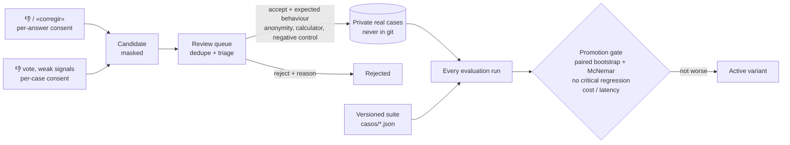

# Learning from real mistakes (`asistente/nucleo/evaluacion`)

Every «esto está mal» becomes a **candidate case**; a human accepts, edits or rejects it; an accepted case is a
**private** regression test that every later evaluation runs; and a prompt or model change (a *variant*) is applied
only if, on the suite plus those real cases, it does **not make the evaluation worse** — with paired statistics, no
critical regression and within cost and latency budgets.



## Map

| File | What it does |
|---|---|
| `captura.py` | 👍/👎 and «corregir»; with the per-answer consent the turn is stored in the case's audit trail, now with the brain's `InformeCerebro`, the specialists' modes, the variant and the model per purpose. |
| `senales.py` | Signals read from the audit trail. Weak ones (`SENALES_DEBILES`): `puerta_cifras` (the figures gate unhappy with the FINAL answer), `afirmacion_rechazada` (verifier), `repregunta`, `abstencion`. |
| `redaccion.py` | Masking before anything becomes a candidate: names (profile + account), e-mail, IBAN, cards, DNI/NIE, phones, CUPS, street addresses, codes (the mail module's `enmascarar`), **amounts, dates and quantities kept**, and the diff (`CambioRedaccion`). |
| `revision.py` | Candidates, the per-case consent «aprender de los fallos», dedupe and triage, acceptance (expected behaviour → deterministic expectations), rejection, the case-store hooks (fact deletion redacts, case deletion erases), export/erasure. |
| `privado.py` | The accepted real cases: a private SQLite file (`EVALUACION_CASOS_REALES_DB_PATH`), linked to the case/user only for export and erasure. |
| `ejecutores.py` | The stable adapters to the brain's packages (`requiere`: `cerebro`, `recuerdos`, `repaso`), resolved lazily; a case whose code is missing is skipped with the reason. |
| `estadistica.py`, `gate.py` | Paired bootstrap, exact McNemar, the promotion rules and the auditable decision report. |
| `reproduccion.py` | Script replays; `guion_de_captura` turns a captured run into a script (the accepted case's standing negative control). |
| `variantes.py` | Prompt roles, including those whose text lives in other packages (`cerebro`, `cerebro_intencion`, `cerebro_sintesis`, `repaso`, and the council's `consejo_miembro`, `consejo_critica`, `consejo_revision`, `consejo_presidente`, `consejo_expediente`). |
| `consejo_eval.py`, `sesgos.py`, `sesgos_falsos.py`, `calibracion.py`, `modelos_consejo.py` | The household council's evaluation: `decision` and `sesgo` cases (`requiere: ["consejo"]`), the bias harness, calibration and «¿Merece la pena el consejo?» — see [../consejo/evaluacion.md](../consejo/evaluacion.md). |

## Where candidates come from

| Origin | Needs | Content | Base priority |
|---|---|---|---|
| `valoracion` | 👎 with the box ticked for THAT answer (consent per answer, as before) | question, answer, the user's correction, the brain's report, trace, snapshot | +40 |
| `voto` | 👎 without the box, on a case with «aprender de los fallos» on | the same, from the audit trail and the request | +30 |
| `senal` | that same per-case consent; only turns AFTER it was given | the turn from the audit trail (the answer rebuilt from the verifier's claims when the trail lacks it) | gate +25, verifier +20, repeat +10, abstention +5 |

Everything is masked first. A candidate is **deduplicated** by the normalised masked question plus the kind of failure
(a «group»; its frequency adds +10·log2 n) and gets +100 when its suggested category is critical in `suite.json` (a
vague signal — a repeat, an abstention — never claims that by itself) and up to +30 for the money at stake
(+6·log10(1+€)). Every term is listed in `motivos_prioridad`, so the order is explainable.

The per-case consent (`PUT /evaluacion/aprendizaje`) is off by default, withdrawable (the pending candidates it produced
are deleted), recorded in the case's audit trail, and its text says what is kept and for what.

## Reviewing (owner or operator)

The owner of a case reviews its candidates in «Revisión de casos» (the `revision` panel); the operator sees every
user's with `X-Operator-Key` (`HACIENDA_OPERATOR_KEY`) or from the command line. Anybody else's candidate answers
404. The reviewer sees the masked conversation, the brain's plan (encargos, dependencies, each specialist's mode and
figures, requests between specialists), what went wrong (signals, the gate's violations, the user's comment) and
the list of what was masked.

Accepting means describing the expected behaviour (`EdicionCaso`): specialists it must / must not involve, minimum
citations, forbidden figures (the wrong ones), an **expected figure that always comes from a calculator** (the
tool, its arguments and the figure that locates the line — the user's by default; the expected value is recomputed
on every run), must abstain, must ask first, the figures gate clean, texts it must / must not contain. The case is
refused (422 with every problem) unless:

1. nothing in it looks personal (`identificadores_en` plus the profile's names) — the reviewer may edit the question
   and the snapshot (replace sensitive values by fictitious ones that reproduce the case);
2. every expected figure can be computed;
3. the expectations **fail on the answer that was actually given** (negative control: an expectation the wrong answer
   passes catches nothing). The reviewer may override this one; the warning stays with the case.

Rejecting needs a reason. Both decisions are told to the user's audit trail (`evaluacion_revision`).

## Privacy

* Candidates (masked) and the per-case consent live in the cases' database and go with the case (SQLite triggers
  plus an explicit `AL_BORRAR` hook) and with the account (`/me` deletion).
* Accepted real cases live in a separate private file (default `evaluacion_casos_reales.sqlite3` next to the
  cases' database, under the git-ignored `data/`). They keep `case_id`/`user_id` only to follow the user: they are
  in `/me/export` (`evaluacion` block) and erased with the case (hook) or the account (`auth.py` block). Another
  user's duplicate accepted into an erased case goes back to the queue.
* Deleting a fact redacts it from the candidates' snapshots and **retires** the accepted cases that used it (privacy
  wins over a regression test) — an `AL_GUARDAR` hook, so every deletion path is covered.
* Withdrawing a feedback (`DELETE /evaluacion/feedback/{id}`) deletes its candidate and its accepted case too.
* The versioned suite refuses real cases (`origen` `feedback`/`senal` in `casos/` fails to load), reports that include
  real cases say so, and CI never sees them.
* Masking is by patterns: a stranger's name that is neither in the profile nor in the account may survive. The
  reviewer's acceptance is the last gate.

## The suite for the household brain

163 cases (30 → 163). Categories added (critical in bold): **`intencion`** (who to consult, in parallel or waiting,
a clarification when ambiguous, small talk and out-of-scope alone), `colaboracion` (a datum reaches another specialist
through the brain: a request or a plan dependency — either is right), **`procedencia`** (every figure attributed to its
specialist; never a cross-specialist sum no tool made), **`memoria`** (recall with origin; another user's memory never
used; a corrected memory wins), `repaso` (every claim and proposal grounded in an input signal), **`paso_directo_fiscal`**
(a tax-only question returns the advisor's own verified answer, figures from the calculator, cited).

New deterministic expectations read the turn's `InformeCerebro` (`especialistas`, `intencion`, `ruta`, `flujo_dato`,
`puerta`, `cifra_atribuida`, `recuerdos`), the pass's output (`repaso`) or the answer (`cifra_ausente`). Cases that
need the brain's code declare `requiere`; the runner runs them through `ejecutores.py` and skips them, with the reason,
when the code is missing — and in a script replay (CI) when they have no script: they run with a model. The original
cases are unchanged and still replay without a model.

`run --motor cerebro` runs every case (the legacy ones too) through the brain: «does the brain keep them?».

## The promotion gate

`promote` runs the active variant and the candidate on the same cases (suite + accepted real cases; the fingerprint
covers both) and promotes only if:

1. the runs are comparable (same cases, complete, against a model);
2. at least `EVALUACION_GATE_MIN_CASOS` (30) paired cases — fewer is «evidencia insuficiente», never a promotion;
3. no case of a critical category scores lower than with the active variant;
4. the paired bootstrap 95 % interval (10 000 resamples, seed derived from the reports: reproducible) of the mean
   per-case difference does not go below 0, and the exact McNemar test does not show more regressions than
   improvements (p < 0.05);
5. cost ≤ `EVALUACION_GATE_COSTE_MAX_RELATIVO` (1.10×) and p95 latency ≤ `EVALUACION_GATE_LATENCIA_MAX_RELATIVA`
   (1.25×, differences under 0.5 s ignored) of the active variant's on the same cases.

«Not worse» is the rule (an equally good, cheaper model may win); a single uncompensated regression among 40 cases
already pushes the interval below 0. The decision and its evidence are written next to both reports
(`promote-<marca>-decision.json` and `.txt`, Spanish) and `prompts registrar --informe …-decision.json` accepts it.

## Commands

```bash
uv run python -m asistente.plataforma.cli.evaluacion casos detectar          # weak signals of consenting cases
uv run python -m asistente.plataforma.cli.evaluacion casos cola              # the queue (groups, priority, reasons)
uv run python -m asistente.plataforma.cli.evaluacion casos candidato cand_…
uv run python -m asistente.plataforma.cli.evaluacion casos aceptar cand_… --desde edicion.json
uv run python -m asistente.plataforma.cli.evaluacion casos rechazar cand_… --motivo "…"
uv run python -m asistente.plataforma.cli.evaluacion casos-reales listar
uv run python -m asistente.plataforma.cli.evaluacion casos-reales comprobar   # each still catches its mistake (no model)
uv run python -m asistente.plataforma.cli.evaluacion casos-reales reproducir --config candidata.json \
    --modelo-real --presupuesto-usd 2                                        # against the model: opt-in, capped
uv run python -m asistente.plataforma.cli.evaluacion promote --config candidata.json   # suite + real cases
```

There is no CI. Run the deterministic suite by hand (`evaluacion validar`, `evaluacion run --reproduccion`). To try
the replay commands without user data, point them at the synthetic real-shaped cases with
`--desde tests/evaluacion/datos/casos_reales_sinteticos.json`.

## API

`GET /evaluacion/consentimiento` (also the per-case consent text), `POST|GET|DELETE /evaluacion/feedback`,
`GET|PUT /evaluacion/aprendizaje?case_id=`, `GET /evaluacion/revision?estado=`, `GET /evaluacion/revision/{id}`,
`POST /evaluacion/revision/{id}/aceptar`, `POST /evaluacion/revision/{id}/rechazar`,
`GET /evaluacion/revision/aceptados`, `DELETE /evaluacion/revision/aceptados/{id}`.

## What the other packages emit for this to work

* The `agent_answer` audit event of a turn (`api.py`, `_finish_agent_turn`) should carry
  `"cerebro": result.cerebro.model_dump(mode="json")` (the `InformeCerebro`, which holds memory **ids** only),
  `"variante": variante_en_uso().id` and `"modelos": {purpose: model}` when known. Without `cerebro` the capture still
  works (no plan, no `puerta_cifras` signal); without `modelos` they are taken from the routing table at feedback
  time and labelled «configuración». An optional `"answer"` would make weak-signal candidates complete (otherwise the
  answer is rebuilt from the verifier's claims).
* The brain: `asistente.nucleo.cerebro.cerebro.Cerebro(asesor=, proveedor=, verificador=, memoria=, fabrica=)` and
  `construir.especialistas_del_hogar`; `run(query, chat_history=, case=, modulos=, conversacion_id=)` returns an
  `AgentResult` with `cerebro`. Worker threads must run under `contextvars.copy_context().run` so the variant in use
  (`usar_variante`) reaches every prompt.
* The weekly pass: `asistente.nucleo.repaso.evaluacion.ejecutar(entrada: dict, *, proveedor) -> dict` with
  `{"texto", "afirmaciones": [{"texto", "senales": [ids]}], "propuestas": [{"texto", "senal": id | None}]}` — until it
  exists the `repaso` cases are skipped with that reason.
* The memory: `recuerdos.servicio.ServicioMemoria` and `recuerdos.servicio.Titular`. The `recuerdos` cases
  (`memoria-real-*`) empty the banks they use, then retain each item as the user's own words (its quote, else its
  text) in the Hindsight bank of its own user and case, so another user's items really are in another bank. They need
  Hindsight running and its model ([memoria.md](memoria.md)).
* Prompts read through `variantes.prompt_activo("<rol>")` (it raises `RolNoDisponibleError`, a `LookupError`, only if the
  package itself is missing); new or edited prompts are registered with `prompts sincronizar --motivo "…"` (or
  `prompts registrar --informe`), until then `tests/evaluacion/test_variantes.py` fails on purpose.
