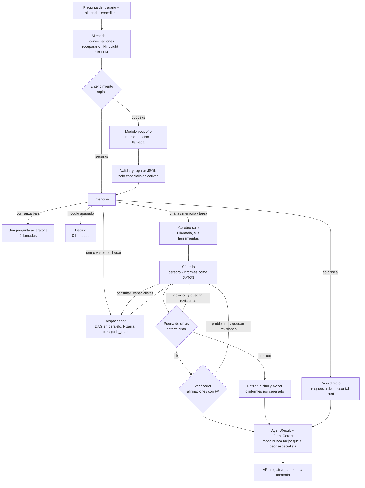

# The household brain (`asistente/nucleo/cerebro`)

Until this package the assistant was a tax advisor with household modules bolted on as `consultar_<x>` tools: its
system prompt began «Eres un asesor fiscal…» and every question, small talk included, went through the tax loop.
The brain turns that around. It is a generalist that **understands** what is asked, **decides** which specialists
to consult (in parallel when they are independent, one after another when one needs another's figure), **merges**
their reports into one answer, and **checks** that answer before the user sees it. The tax advisor is one of its
specialists, with its rigour intact: the same loop, the same BOE citations, the same verifier.

`CEREBRO_MODO=hogar` (the default) serves the brain; `CEREBRO_MODO=fiscal` serves the single advisor exactly as it
was (the legacy mode, still tested). Decision record: [ADR 0003](../adr/0003-cerebro-del-hogar.md).

## Map

| File | What it does |
|---|---|
| `contrato.py` | The shared types (plan, reports, figures, memory, gate, turn report). Written first; every part builds against it. |
| `intencion.py` | Understanding → `Intencion`: rules first, the small model only when unsure, a clarification below the threshold. |
| `data/vocabulario.json` | The curated Spanish vocabulary of each specialist, small talk, memory, actions and follow-ups. |
| `fiscal.py` | `EspecialistaFiscal`: the tax advisor (`TaxAgent`/`TeamAgent`) as a `contrato.Especialista`. |
| `herramientas.py` | The brain's own tools: `consultar_especialistas` (replanning), tasks, research, the planner, the decisions memory. |
| `cerebro.py` | `Cerebro.run`: the pipeline, the synthesis loop and its gates. |
| `prompts.py` | `CEREBRO_SYSTEM_PROMPT`, `INTENCION_SYSTEM_PROMPT`, `SINTESIS_SYSTEM_PROMPT` (prompt roles `cerebro*`). |
| `construir.py` | Wiring from settings: the legacy advisor as the tax specialist, the household specialists, the memory. |
| `colaboracion/` | The collaboration runtime (dispatcher, switchboard, figures gate): see its own docs. |

## One turn

1. **Memory.** `ProveedorMemoria.recuperar(case_id, user_id, consulta, conversacion_id, limite)` (the conversation
   memory, `asistente.nucleo.recuerdos` on Hindsight; `MemoriaNula` when it is off or missing). One recall request
   to Hindsight, which ranks with its local embedder and reranker and makes no language-model call. It never raises
   and never waits for Hindsight to start: while the daemon starts, the turn goes on without memory. Its block
   reaches the brain's prompt and the tax specialist's as DATA ([memoria.md](memoria.md)).
2. **Understanding** (`intencion.Entendimiento.entender`). See below.
3. **Fast paths.** A clarification or a switched-off module: answered with no model call. Small talk, a memory
   question, a task with no domain: the brain alone (one call; small talk gets no tools). ONE specialist and it is
   the tax one: **paso directo** — the advisor's own `AgentResult` is returned unchanged (answer, mode, citations,
   claims, team report), only `cerebro` is attached.
4. **Collaboration.** The encargos go to `colaboracion.Despachador`, which runs them as a DAG (bounded parallelism,
   context copied into worker threads, per-encargo timeout, budget stop, dedupe) and lets a specialist ask another
   for a datum through the `Pizarra`. Each returns an `InformeEspecialista` with its text, `[F#]` and `Cifra`s.
5. **Synthesis** (purpose `cerebro`, prompts `cerebro` + `cerebro_sintesis`). The reports are passed as a DATA block
   (`colaboracion.material_de_sintesis`: neutralised text, a figures table per report). The brain may consult again
   (`consultar_especialistas`, at most `CEREBRO_MAX_REPLANES` times) and use its tools; the draft streams as
   `text_delta`.
6. **Gates** (below), at most `CEREBRO_MAX_REVISIONES` revisions.
7. **Result.** `AgentResult` (the API's shape, unchanged) with `cerebro: InformeCerebro` (plan, route, reports'
   summaries with their figures, requests between specialists, the gate's verdict and attributions, the memory items
   used, revisions, duration). After answering, the API hands the turn to the memory (`registrar_turno`), which
   sends only the user's message, after the privacy gates, to Hindsight.

## Understanding: rules first, the model when unsure

`intencion.senales` reads the normalised message (lower case, no accents) against:

* **each ACTIVE specialist's vocabulary** — a curated table per key (`data/vocabulario.json`: strong terms weigh
  3–5, weak ones 1; `deduc*` is a stem) plus what each module says of itself (a module without a table row gets
  its name's words as strong terms and its description's distinctive words as weak ones; every module gets the
  multi-word labels of its facts). Terms match **longest first, consuming their span**: «renta mínima» is the
  benefits specialist's and does not also count as «renta» for the tax one;
* the module's **facts in the case** (a +0.5 prior: it breaks ties, never decides alone);
* **the past** («lo que te dije», «la otra vez» → `necesita_memoria`; «¿qué te dije de…?» → `memoria`);
* **small talk** (a short message made only of greeting/thanks words, or «¿qué puedes hacer?»);
* **actions** — tasks and reminders anywhere in the message; an imperative only at its start («prepara…», «da de
  baja…», after «por favor» / «puedes»…), so «¿cuándo se presenta el 303?» is a question, not an order;
* **follow-ups** — a short elliptical message («¿y en 2024?», «sí, úsalo») with no signal of its own inherits the
  previous question's route: an answer to the advisor's question («¿lo uso para tu deducción?») reaches the advisor,
  whose `aceptar_propuesta` checks the user's literal yes.

The rules are **confident** when one domain scores ≥ 3 and every other one is weak (< 2) or both weaker than 3 and
at most half of it; or for small talk, a memory question, a task, a switched-off module, an inherited follow-up.
Their confidence is `min(0.97, 0.55 + 0.08·top) × (1 − 0.5·second/top)`: explainable term by term
(`Senales.explicacion()` → `fiscal=4 (deduc*); suscripciones=2 (gimnasio)`). The calibration table
(`tests/cerebro/test_intencion_tabla.py`, 61 Spanish phrasings) pins what they decide.

Otherwise — two strong domains (a cross-domain question that needs sub-questions and dependencies), a weak or no
signal — the small model (`cerebro:intencion`, tier `pequeno`) is asked ONCE with the active specialists, the rules'
signals, the last four messages (neutralised) and the message, for strict JSON (`prompts.INTENCION_SCHEMA`).
`validar_del_modelo` repairs what it can without guessing (unknown or inactive specialists dropped, ids renumbered,
unknown dependencies removed, every dependency dropped on a cycle, the type made consistent, the confidence clamped)
and rejects the rest; a rejected answer or a failing model falls back to the rules' plan (`origen="respaldo"`: every
strong candidate, each sub-question naming its part, the curated dependency «the tax specialist waits for the
mortgage's yearly payments when deductions are at stake»). A spent budget propagates (429), as with the advisor.
Below `CEREBRO_UMBRAL_CONFIANZA` (0.45) the result is ONE clarifying question instead of a guess.

## The tax specialist

`EspecialistaFiscal` runs the advisor through three hooks of `TaxAgent` whose defaults keep the legacy advisor
byte for byte:

* `herramientas_del_hogar = False` — no `consultar_<x>`, tasks, research or planner: the brain coordinates those;
* `_nuevo_ledger()` → the turn's **shared** ledger through `LedgerAnotado`, so fragment ids are unique across every
  specialist of the turn, the tax answer may cite another specialist's `[F#]`, and the report knows its own ids;
* `_aportes_del_turno()` → the encargo, earlier reports and the memory as a DATA block, plus `pedir_dato`.

The user's question stays the advisor's `query` even for a sub-question: `registrar_hechos` records only what the
user wrote and reads it from `query` and the history; an encargo is model-written and may carry other specialists'
figures, so it travels in the data block and can never become «the user's words». Case changes are merged into the
shared case (only the facts the advisor changed; a parallel specialist's facts are kept). `aceptar_propuesta` stays
in the tax specialist: a module's proposal is a value for a TAX fact, offered when it matters to a tax question and
used by its calculators. A request from another specialist runs the single advisor (no team), without requests of
its own at the maximum depth. Its report carries `modo`, the warnings, the trace, its fragments and the figures of
its own calculations (read with `colaboracion.cifras.extraer_cifras`).

## The gates, and why

| Gate | Checks | Why |
|---|---|---|
| Figures (`colaboracion.revisar_cifras`, deterministic, free) | every number of the draft is a specialist's or a brain tool's figure, the user's own words (this conversation's messages and the literal quotes the remembered items rest on) or the literal of a source cited in the same sentence; no figure is a sum/difference (or ×12, ÷12) of different specialists' figures no tool combined; whose figure the answer says it is, is right; every `[F#]` exists | The synthesis is the one place where a model holds figures from several calculators at once: an «obvious» total («entre las dos cosas ahorras 2.350 €») or a mis-attributed figure would appear there. Code checks it, not the prompt. |
| Verifier (the advisor's `Verifier`, one call) | every claim citing a fragment says what the fragment says | A restated legal rule must still say what its source says; a calculation's figure must match its line. |

The figures gate runs first: a draft with an invented figure is rewritten before a verifier call is spent on it.
Revision messages are precise (the gate's own message per kind of violation, and the verifier's claim-by-claim
reasons). After `CEREBRO_MAX_REVISIONES`:

* a figure still without origin is **withdrawn** from the text (`[cifra retirada: no sale de ningún cálculo]`) with
  a warning; an inexistent `[F#]` is removed; the mode is at most `partially_verified`;
* when nothing of the draft survives the verifier, or the synthesis model fails / the budget runs out after the
  reports arrived, the **specialists' own reports are shown as they are** (their figures are their tools');
* the final mode is never better than the worst specialist's (`tope_de_informes`: a partially verified or
  unverified specialist caps it at its mode; one that could not answer, asked the user or abstained caps it at
  `partially_verified`, and the warning says which part is missing).

Paso directo is not re-gated (the advisor's own verifier already ruled); its figures gate runs for information only
(the UI's «¿De dónde sale cada cifra?»).

## Cost and latency

| Route | Extra model calls over the specialists' own | Typical share |
|---|---|---|
| Clarification, module switched off | 0 | rare |
| Small talk | 1 synthesis call, no tools | small |
| Paso directo (tax only) | **0** (no understanding model, no synthesis, no second verifier) | most tax questions |
| One household specialist | 1 synthesis call (+1 verifier when it cites) | most household questions |
| Cross-domain | 1 small-model call (understanding) + 1 synthesis (+1 verifier) (+1–2 per revision) | the hard ones |

Specialists of one plan run in parallel (`CEREBRO_MAX_PARALELO`), so a two-domain question costs about the slowest
specialist plus the synthesis, not their sum. Every call is metered under its purpose and counts towards the
question's budget (`LLM_MAX_CALLS_PER_QUESTION`); worker threads run in a copy of the caller's context. One cost is
outside the table: with the conversation memory on, Hindsight makes its own extraction calls
(`HINDSIGHT_LLM_MODELO`) for each retained message, after the answer. They are not metered under any purpose and do
not count towards the question's budget ([memoria.md](memoria.md)).

## Streaming and the UI

Events (`on_event`): `plan` (the `Intencion`; again with `replan: true`), `especialista` (`start`/`done` per run),
`peticion`, `sintesis`, `puerta` (`violaciones`), plus the advisor's own (`thinking`, `text_delta` — only the
paso directo's or the synthesis's draft —, `tool_call`, `tool_result`, `verifying`, `revising`). The chat shows the
live plan («Consulto a Hipoteca e Impuestos en paralelo», each specialist's state), and under the answer «Consulté
a: Hipoteca · Impuestos» and «¿De dónde sale cada cifra?» (figure → specialist → source;
`frontend/src/components/ProcedenciaRespuesta.tsx`). The request carries `conversacion_id` (the chat's own id, a new
one per chat) for the conversation memory.

## Settings

| Setting | Default | What |
|---|---|---|
| `CEREBRO_MODO` | `hogar` | `hogar`: the brain; `fiscal`: the single advisor as it was. |
| `CEREBRO_UMBRAL_CONFIANZA` | `0.45` | Below it, one clarifying question. |
| `CEREBRO_INTENCION_MODELO` | `true` | `false`: rules only (no `cerebro:intencion` call ever). |
| `CEREBRO_MAX_PASOS` | `6` | Model steps of the synthesis (tools included). |
| `CEREBRO_MAX_REVISIONES` | `2` | Revisions after a failed gate. |
| `CEREBRO_MAX_REPLANES` | `2` | `consultar_especialistas` calls per turn. |
| `CEREBRO_MEMORIA_LIMITE` | `8` | Remembered items per turn. |

The collaboration runtime adds its own (`CEREBRO_MAX_PARALELO`, `CEREBRO_TIMEOUT_ENCARGO_S`,
`CEREBRO_MAX_PROFUNDIDAD_PETICIONES`). Routing rows: `cerebro` (`grande`), `cerebro:intencion` (`pequeno`).

## What is not verified

* The synthesis's **prose** (recommendations, framing) is not checked beyond its cited claims and its numbers; an
  answer that cites nothing is `unverified` and says so.
* The figures gate checks **values and attribution**, not that a figure is used for the right concept («ahorro»
  vs «coste»): the figures table gives each figure's concept and the answer must name whose it is, but a model that
  copies the right number under the wrong label is caught only when the verifier sees the cited calculation.
* A household specialist's figures are its calculators' over the household data: they are as good as those data
  (the module's own docs say what each one assumes). They are attributed, not re-derived.
* Understanding can misroute an ambiguous message; the plan is shown live and in the answer («Consulté a…»), and
  the brain can consult again during the synthesis.
* Which remembered items an answer «used» is approximate: those it names by id, or all of them on a memory
  question.
