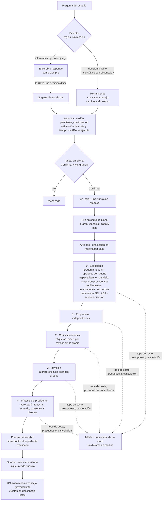

# The household council (`asistente/nucleo/consejo`)

For HARD household decisions — «¿amortizo o invierto?», «¿acepto la herencia o renuncio?», «¿compro o sigo de
alquiler?» — the brain can turn into a **council**: several AI members first work on their own, then critique each
other anonymously, revise, and a chair writes a ruling that shows consensus AND dissent. The council never computes a
figure and never decides what the law says: the brain's specialists build a verified, pseudonymised dossier first,
and every figure the council uses is one of theirs. It is offered only for hard decisions, always with a cost
estimate the user confirms, runs in the background and arrives as a «Dictamen del consejo».

Decision record: [ADR 0004](../adr/0004-consejo.md). The engine (phases 1–4, anonymity, aggregation, the chair):
[deliberacion.md](deliberacion.md). Its evaluation (bias harness, decision cases): `evaluacion.md`.

## Map

| File | What it does |
|---|---|
| `contrato.py` | The shared types (dossier, proposals, anonymous critiques, rankings, ruling, session). |
| `deteccion.py` | `es_decision_dificil`: is this a hard decision, and why (deterministic, explainable; no model). |
| `expediente.py` | Phase 0: `construir_expediente` / `instruir` — neutral question and options behind a gate, the specialists' figures, facts, constraints, the SEALED preference. |
| `seudonimos.py` | `seudonimizar_perfil` (per-domain allowlist) and `seudonimizar_texto` (identifiers, names, origin, gender, injection): pure and deterministic. |
| `prompts_expediente.py` | `EXPEDIENTE_SYSTEM_PROMPT` (prompt role `consejo_expediente`) and its JSON schema. |
| `estimacion.py` | The cost and time estimate before confirming (routing + price table, Decimal), the hard cap. |
| `almacen.py` | The sessions' store (state machine, leases, JSON blobs, export, erasure, retention). |
| `servicio.py` | Convene / confirm / reject / cancel, the job, the background start, the per-session meter and cap, the gates on the ruling, the notification; the brain's `convocar_consejo` tool. |
| `deliberacion.py`, `miembros.py`, `anonimato.py`, `agregacion.py`, `presidente.py`, `prompts.py` | The engine (agent F): see `deliberacion.md`. |

Outside the package: `asistente/plataforma/api/routers/consejo.py` (API), `asistente/plataforma/cli/consejo.py` (CLI and
the worker's job `consejo`), `asistente/plataforma/migraciones/catalogo/consejo.py` (schema), the brain's
`cerebro/herramientas.py` + `cerebro/prompts.py` (`ADDENDUM_CONSEJO`), and the UI (`frontend/src/apiConsejo.ts`,
`components/ConvocarConsejo.tsx`, `components/DictamenConsejo.tsx`, `paneles/consejo.tsx`).

## The life of a session

States: `pendiente_confirmacion` → `en_cola` → `instruyendo` → `deliberando` → `sintetizando` → `terminada` |
`fallida`; `rechazada` (the user said no), `cancelada` (by the user, or a convocation not confirmed in
`CONSEJO_CADUCIDAD_HORAS`). Every transition is one conditional `UPDATE … WHERE estado IN (…)`; the claim is a
`BEGIN IMMEDIATE` transaction that never takes two sessions of one case nor a case with a live lease.

## When the council is offered: the detector

`deteccion.es_decision_dificil(pregunta, intencion, case)` scores explainable signals (each with a Spanish reason in
`Deteccion.motivos`):

| Signal | Weight | Examples |
|---|---|---|
| A choice (needed) | 2 (+0.5 with written alternatives) | «¿X o Y?», «me conviene», «debería», «merece la pena», «dudo entre», a first-person «¿acepto…?», «¿vendo…?» |
| Hard to undo | 2 | inheritance (accept / renounce), selling, buying a home, cancelling a loan, appealing, signing, retiring, rescuing a pension plan, donating, leaving a job |
| Weighty topic | 1 | mortgage, home, inheritance, retirement, savings, investing, pension plan, self-employment, loan |
| Commits savings | 1 | amortising, a pension plan, investing |
| Large amount | 1.5 | ≥ `CONSEJO_IMPORTE_GRANDE_EUR` in the text, or the case's mortgage capital when the question is about it |
| Several domains | 1 | the brain's plan consults several specialists |
| Declared doubt | 1 | «no lo tengo claro», «me da miedo», «si sube el euríbor» |
| Small amount | −1.5 | an explicit amount under 1.000 € |

Hard = a choice AND something at stake AND a score ≥ 3.5. **Factual questions are never hard** («¿cuánto me ahorro
si amortizo…?», «¿qué pasa si renuncio…?», «¿cuándo…?»): computing is the specialists' job. The user's explicit
request («consúltalo con el consejo», «que lo estudie el consejo») always is — «dame un consejo» (advice) is not. The
table `tests/consejo/test_deteccion.py` (61 Spanish phrasings) pins the behaviour.

WHY rules and not a model: the offer must be cheap (it runs on every turn of the brain), deterministic (tests,
explanations) and conservative. The model proposes the convocation; the rules decide whether the tool even exists on
that turn; the user decides whether it runs.

## The brain's tool

`herramientas_del_cerebro` (shared, additive hunk) adds `convocar_consejo(pregunta, opciones?, motivo)` and the
paragraph `prompts.ADDENDUM_CONSEJO` ONLY when the detector says the turn's question is hard (its verdict travels as a
hint: «Parece una decisión difícil (…)», data for the brain, not an order). The tool **never runs the council**: it
creates the pending session (`servicio.convocar_desde_cerebro`) and returns the sentence the answer must carry
(«Te propongo consultarlo con el consejo: coste estimado 0,40 USD, unos 3 minutos. Confírmalo en la tarjeta.»); its
figures are the brain tool's own, so the figures gate accepts them. The session keeps the USER's question (the
model's restatement only when the user just said «consúltalo con el consejo»), their previous messages (masked, at
most four) and the brain's reasons.

The chat (`Hilo.tsx` → `ConsejoEnHilo`) lists the case's pending and running sessions after each turn and renders a
`ConvocarConsejo` card for each: estimate, cap, time, members, «Confirmar» / «No, gracias»; then the live phases with
«Cancelar»; then the ruling on demand. When the last question looks hard but nothing was convened (the tax-only
«paso directo» does not offer tools), the card offers it quietly (`POST …/consejo/detectar`, no model).

## Phase 0: the dossier

`expediente.instruir` (see its docstring for every rule):

1. **Neutral framing** behind a gate (`validar_planteamiento`): the small model (`consejo:expediente`) rewrites the
   question neutrally and lists 2–6 options; accepted only if the options are mutually exclusive (no duplicates, none
   contained in another), cover the question (every alternative the user wrote is among them), the wording is
   neutral (no leading phrases, not the user's own quote) and the leaning it extracts rests on the user's literal
   words (`procedencia.cita_valida`). Otherwise rules: the user's «X o Y», the brain's suggested options, or «do it /
   keep things as they are», with a template question. The model reads the question already pseudonymised.
2. **Figures**: the specialists the question and its options need (the brain's understanding rules, no model; the
   tax specialist by default) run through the collaboration runtime (`Despachador`: parallel, bounded, budget-aware)
   on encargos derived from the options: «calcula para CADA opción…; no recomiendes». The tax advisor's query is the
   NEUTRAL question. Every `Cifra` keeps its provenance (specialist, tool, fragment); they are exact. A specialist
   that cannot answer becomes a declared gap (`incertidumbres`). Case changes and actions proposed in this phase are
   discarded: the council never writes to the case.
3. **Facts**: the specialists' reports (minus sentences that echo the user's leaning), the minimum profile, the
   decisions memory as `restricciones` (in force, of the domains involved, with their date), the conversation memory
   (Hindsight, [../cerebro/memoria.md](../cerebro/memoria.md)) as facts with their origin (the item's id and the date
   the user said it, or «fecha desconocida»).
4. **The preference, SEALED** in `preferencia_usuario`: the one the user gave when convening, else the quote-checked
   one, else the rules' («prefiero…», «me inclino por…», «creo que voy a…»); a remembered fact that states a
   leaning («prefiere…», «no quiere…», «le gusta…», «evita…», «descarta…») and shares words with THIS decision's
   options joins it. Hindsight has no preference type, so the dossier recognises them by their wording. Members see it only in the revision round (sycophancy: told what the user wants, a model tends to agree).

## Anti-bias measures, and why

| Measure | Where | Why |
|---|---|---|
| Neutral question, options checked by code | phase 0 | A leading question invites agreement; overlapping or missing options make the vote meaningless. |
| Preference sealed until the revision | phase 0 + engine | Round 1 must weigh the options, not the user's hopes (sycophancy). |
| Minimum, pseudonymised profile | `seudonimos` | An attribute the decision does not depend on (sex, origin, religion…) can only bias; the counterfactual test checks that swapping them gives the SAME dossier byte for byte. |
| Independent proposals in parallel | engine | No anchoring on the first opinion. |
| Anonymous critiques: labels, order per reviewer, same schema, length caps, no self-review, fixed rubric | engine (`anonimato`) | Position, self-preference, verbosity and style biases. |
| Robust rank aggregation, agreement measured, dissent kept | engine (`agregacion`, `presidente`) | One loud reviewer cannot flip the ruling; the minority's case is part of the ruling. |
| Different model families when configured | engine (`miembros`) | Models of one family share blind spots. |
| Figures only from the dossier, gated | engine + service | The council reasons, it does not compute. |
| Authorship revealed only at the end | engine + API | Transparency without biasing the critiques. |

H's harness (`asistente.nucleo.evaluacion.sesgos`) measures position, self-preference, counterfactual fairness and
sycophancy on any engine; the council is kept only if the promotion gate shows it is not worse than the single brain
on decision cases.

## Privacy

What leaves the server (to the members' model providers) is ONLY the pseudonymised dossier:

* **profile**: a per-domain allowlist (`seudonimizar_perfil`): age, autonomous community, tax residence, marital
  status WITHOUT grammatical gender, dependants, legal categories (recognised disability «≥33 %» / «≥65 %» — never
  the diagnosis or the exact grade —, large family, single parent), income by state IRPF bracket, self-employment,
  home tenure, the mortgage's type and years left; per domain a few more (tax: pension contributions, pre-2013
  home…). Names, documents, contact data, sex, nationality/origin, religion, health, specially protected situations
  and birth dates are dropped; anything else not allowlisted is dropped and only COUNTED;
* **free text** (`seudonimizar_texto`, with the privacy gates of `asistente/nucleo/privacidad.py`): credentials redacted, IBAN/cards/DNI/phones/e-mails
  /long numbers masked, names replaced (by context «me llamo…», «mi hermana Lucía» → «mi hermana», «Sr./Sra.», and a
  list of common given names), origin and nationality removed, gendered self-descriptions made neutral («viuda» →
  «viudo/a»), injection bait from mail/web/memory neutralised; memory items with special-category data are left out;
* `anonimizado` lists what was removed (never the values) and the UI shows it («Qué supo el consejo de ti y qué se
  anonimizó»).

The specialists' figures stay EXACT: they are the decision's substance, computed by tools from the case (the
specialists run inside the server, as on any turn). The stored session (question as the user wrote it, dossier,
deliberation, ruling) is per case and owner; it is in `GET /me/export` (`consejo` of each case), erased with the case
and the account (triggers + `DELETE /me`), and purged `CONSEJO_RETENCION_DIAS` after it ends. Limits: names are found
by context and a list, not by a model — a rare name written alone may pass; the user's original question is stored
(for them), never sent to the members.

## Cost

`estimacion.estimar` (no model): calls per phase (the dossier's model and specialists; proposals, critiques,
revision per member; the chair; the verifier), prompt and output sizes from the dossier and the number of members,
priced per purpose with the routing table and the price table (USD/MTok, Decimal). An unknown price uses the most
expensive known model (an upper bound); a local model costs nothing. The cap is estimate × `CONSEJO_FACTOR_TOPE`,
never above `CONSEJO_TOPE_MAX_USD` (an estimate above it is not offered).

At run time every call goes through `MeteredProvider` with the session's own store (`_ConsumoDeSesion`: the usage log
as always, plus the session's total) and budget (`_PresupuestoDeSesion`): before each call it checks the app's daily
limits, the session's call cap (`CONSEJO_MAX_LLAMADAS`) and the cap the user accepted; a cancellation stops the next
call the same way. The engine also projects each phase's cost and does not start one that would exceed what is left.
Past the cap nothing more is called: the engine either rules with what it has (a partial ruling written by code, said so in the ruling) or the session ends `fallida` and says so; nothing is invented to fill the gap. The cost spent is
shown with the ruling.

## API

| Endpoint | |
|---|---|
| `GET /cases/{case_id}/consejo` | sessions, newest first (state, estimate, cost, recommendation in words) |
| `POST /cases/{case_id}/consejo` `{pregunta, opciones?, preferencia?}` | convene: pending session with its estimate (no model) |
| `POST /cases/{case_id}/consejo/detectar` `{pregunta}` | the detector's verdict (no model) |
| `GET /cases/{case_id}/consejo/{id}` | live progress; at the end the ruling, the dossier (with `anonimizado`), proposals, critiques, rankings — authorship revealed only once `terminada` (before: «miembro_a»…) |
| `POST …/{id}/confirmar` · `…/rechazar` · `…/cancelar` · `DELETE …/{id}` | the user's decisions (a double confirm queues once: `confirmada_ahora`) |

API key, session and ownership as every `/cases/{id}/…` endpoint; a session of another case is a 404. CLI:
`python -m asistente.plataforma.cli.consejo convocar|estado|ejecutar`.

## Operation

| Setting | Default | |
|---|---|---|
| `CONSEJO_ACTIVO` | `true` | off: never offered, convening refused (stored sessions stay readable) |
| `CONSEJO_FAMILIAS` / `CONSEJO_MIEMBROS` / `CONSEJO_MAX_PARALELO` / `CONSEJO_SEMILLA` | — / the four default seats / `3` / — | the engine's families, seats, parallelism and presentation seed (`deliberacion.md`) |
| `CONSEJO_FACTOR_TOPE` / `CONSEJO_TOPE_MAX_USD` | `2.0` / `3.00` | the hard cap |
| `CONSEJO_MAX_LLAMADAS` | `150` | calls of one session in all |
| `CONSEJO_EN_SEGUNDO_PLANO` | `true` | start at once in a thread of the API process (single-process deployments) |
| `CONSEJO_PLAZO_FASE_S` | `600` | deadline of one deliberation phase for all its members together; a member still running is left out of that phase (keep it below `CONSEJO_ARRIENDO_S`) |
| `CONSEJO_ARRIENDO_S` / `CONSEJO_MAX_INTENTOS` | `900` / `2` | the lease, renewed on every phase; runs of a crashed session |
| `CONSEJO_CADUCIDAD_HORAS` / `CONSEJO_RETENCION_DIAS` | `72` / `365` | expiry of unconfirmed convocations; retention |
| `CONSEJO_IMPORTE_GRANDE_EUR` | `10000` | «large amount» for the detector |

Routing rows: `consejo:miembro:*` (mediano), `consejo:presidente` (grande), `consejo:expediente` (pequeno). Job:
`consejo` every 5 minutes (`python -m asistente.plataforma.cli.consejo ejecutar`): expire convocations, fail sessions
whose runs are exhausted (with a notification), run the confirmed ones, apply the retention. It never fails because a
session did.

## What is not verified

* The members' reasoning is checked for its figures (the gate) and the claims it cites (the verifier, advisory on the
  ruling); the quality of a judgement is measured by the evaluation, not by a gate.
* The estimate is an estimate: real token counts vary; the cap is what is guaranteed.
* Name detection in free text is by context and a list (see Privacy).
* The dossier's figures are the specialists' over the household data: as good as those data.
