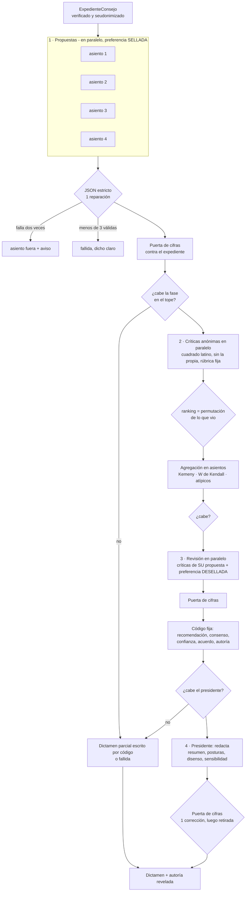

# The council's deliberation engine (`asistente/nucleo/consejo`)

The engine runs phases 1–4 of a council session over a verified, pseudonymised dossier (`ExpedienteConsejo`, built by
the brain's specialists — see `arquitectura.md`): independent proposals, anonymous cross critiques, revision, and the
chair's synthesis into a `Dictamen`. It implements `contrato.MotorDeliberacion` as `deliberacion.Deliberacion`
(`construir_motor()` wires it from settings). Its job is to make the **mechanics provably fair**: who wrote a proposal,
where it was shown, how long or polished it is, what the user prefers and what the chair would like to say must not
decide the ruling. What decides it is computed by code; models only reason and write.

## Map

| File | What it does |
|---|---|
| `miembros.py` | The seats (`ROLES_POR_DEFECTO` + optional `largo_plazo`), the chair, and who fills each seat: family round-robin, effort variation, purpose per seat (`FabricaProveedores`). |
| `prompts.py` | The four role prompts (`MIEMBRO_`, `CRITICA_`, `REVISION_`, `PRESIDENTE_SYSTEM_PROMPT`, registered roles `consejo_*`), the JSON schemas, the messages (dossier block with the preference sealed). |
| `anonimato.py` | Anonymous presentation: own proposal excluded, labels by position, per-reader seeded orders, the balanced Latin-square design, identity/style normalisation. |
| `agregacion.py` | Pure functions: Borda, Kemeny–Young (exact ≤ 6), Copeland, Schulze, Kendall's W (complete and incomplete designs, tie correction), outlier reviewers, consensus label, council confidence. |
| `presidente.py` | What code fixes vs what the chair writes, the chair's message and validation, the figures gate over the dossier, the ruling written by code when there is no chair, the `Dictamen` assembly. |
| `deliberacion.py` | `Deliberacion.deliberar`: phases, parallelism, strict validation and repair, cost accounting and the cap, events, the audit trail. |

## One session



1. **Propuestas.** Every seat, in parallel (at most `CONSEJO_MAX_PARALELO` threads; each in a copy of the caller's
   `contextvars`, so metering and the prompt variant reach its calls), reads the identical dossier — the user's
   preference sealed — and returns a `Propuesta` as JSON. **Strict validation** (`validar_propuesta`): the
   recommendation is a dossier option id or `depende` (then `condicion` is mandatory), confidence a number in [0, 1],
   reasoning present, lists of strings, figure ids; length caps are enforced by cutting, never by rejecting. An
   invalid output gets **one repair attempt** (the reason and the previous answer go back to the model); a seat that
   still fails is dropped with a warning. Fewer than `MIN_MIEMBROS` (3) valid proposals → `fallida`, with the reason.
2. **Figure discipline.** Every number of every proposal goes through the brain's figures gate
   (`colaboracion.revisar_cifras`) over a closed world: pseudo-reports holding the dossier's `Cifra`s (one per
   specialist, so a cross-specialist sum is told apart), the dossier's citable `[F#]`, and the dossier's own texts
   (question, options, facts, profile, constraints, uncertainties; the preference only once unsealed) as «the user's
   words». A figure id the dossier does not have is a violation too. Violations are not fixed silently: reviewers see
   them next to the proposal (`comprobacion_cifras`), the author must fix them in its revision, the chair sees the
   final ones, the ruling lists them.
3. **Críticas.** Each member reviews the OTHER proposals, anonymised (below), with a fixed 1–5 rubric (rigor,
   completitud, prudencia, claridad, ajuste_al_caso), concrete errors by type (`cifra`, `supuesto`, `omision`,
   `logica`, `ley`, `riesgo_ignorado`) and a ranking. **Validation:** exactly one critique per label seen, no unknown
   label, integer scores 1–5, and the ranking must be a permutation of exactly the labels the reviewer saw. One repair;
   a reviewer that still fails loses its critiques, not its proposal. Rankings are translated to seats on the server.
4. **Revisión.** Each member reads the critiques of ITS proposal (anonymous, shuffled per seat; identity markers
   stripped), the figure check of its proposal and — now — the user's preference, and revises. The prompt says it may
   change only for reasons, never to please the user; `cambios` is mandatory. A member that cannot revise stands by
   its round-1 proposal (said so). Only the devil's advocate is told which option led round 1 (`ROLES_CONTRARIOS`):
   its mandate is to argue against it; telling the others would pull them towards the majority.
5. **Síntesis.** Code fixes the result; the chair writes the prose; the figures gate runs; authorship is revealed.

## Fairness mechanics, and why each one

| Bias | Mechanism | Where |
|---|---|---|
| Self-preference | A reviewer never sees its own proposal; an item missing from a ranking is «not ranked», never «last» or «first». | `anonimizar_para`, `agregacion` |
| Authorship / affinity | Labels A, B, C… carry no identity; normalisation strips self-references («como fiscal…», «desde mi mandato…», «como modelo de IA…»), seat names and ids, model and vendor names, signatures. Critiques reach their addressee the same way. | `anonimato.Limpiador` |
| Style / verbosity | Same schema for everyone, markdown and emojis removed, line breaks flattened, every text capped, confidence rounded to 0.05 (no fingerprint in «0,73»), figure ids sorted; the rubric prompt says length and polish are not merit. | `normalizar_propuesta`, `CRITICA_SYSTEM_PROMPT` |
| Position | Labels follow the order shown and the order changes per reader. The default **balanced design** goes further: every proposal is shown **exactly once in every position** across the reviewers, so a purely position-driven reviewer pool produces W = 0 and no winner. | `diseno_equilibrado` |
| Sycophancy | The user's preference is sealed in round 1 and in the critiques, unsealed only for the revision, where the prompt treats it as a datum about values, not an argument. | `bloque_expediente(con_preferencia=…)` |
| Conformity | Members never learn the provisional vote (only the devil's advocate learns the leading option, by mandate); critiques say what is wrong, not how others voted. | `mensaje_revision` |
| Chair's bias | The chair cannot set the recommendation, the consensus label, the confidence, the agreement or authorship (ignored and reported); it must state the minority's best case when the council is not unanimous; it gets W in words, not numbers it could copy. | `presidente.validar_redaccion`, `CAMPOS_FIJOS` |
| Outlier reviewer | Flagged (shown to the chair and in the ruling), never silently dropped. | `revisores_atipicos` |

**The balanced design.** With `n` seats each reviewer sees `n − 1` proposals. Take the cyclic Latin square of order
`n` and drop the diagonal: reviewer `i` sees seats `i+1, …, i+n−1 (mod n)`. Row `i` never contains `i`; column `c`
holds `{i + c + 1 mod n}` = every seat once. Relabelling the seats with a seeded permutation σ (applied to rows and
symbols alike) and permuting the `n − 1` columns with a seeded τ preserve both properties, so the design is fresh per
session but always balanced (`tests/consejo/motor/test_anonimato.py` checks it for 2–7 seats and several seeds).
It balances positions, not carry-over (which proposal follows which).

**Reproducibility.** Orders come from SHA-256 of (seed, session, reader): stable across processes and Python
versions. The seed is `semilla`, else `CONSEJO_SEMILLA`, else derived from the session id (so two sessions never share
orders but each is reproducible). Results are collected in seat order whatever the thread timing; aggregation ties are
broken by a documented key. Same seed + scripted providers ⇒ identical `SesionConsejo` (tested, sequential = parallel).

## Aggregation and agreement

Rankings are aggregated in **seat space** (each reviewer's labels translated through its own map).

* **Kemeny–Young**, exact, for ≤ 6 candidates: the order agreeing with the most pairwise preferences
  (Σ over pairs a before b of N[a, b]); brute force over `n!` orders × `n(n−1)/2` pairs = O(n!·n²), ≈ 10⁴ steps at 6.
  Ties between optimal orders: closest (Kendall distance) to the Borda order, then the tie-break key. Above 6 (a
  7-seat council) **Schulze** (widest paths, O(n³)) with Copeland and Borda as tie-breakers.
* **Borda** with ties and partial rankings: `(k − midrank)/(k − 1)`, averaged over the rankings containing the item.
* **Kendall's W.** Complete rankings: `W = 12S / (m²(n³ − n) − m·ΣT)` (textbook, with tie correction). The council's
  design is incomplete (each reviewer ranks `n − 1` of `n`), where the textbook denominator would make perfect
  agreement < 1; so `W = S / S*`, `S = Σ_j (R_j − E_j)²` with each item's expected rank sum `E_j`, and `S*` the `S` of
  perfect agreement with the best consensus order, exact by dynamic programming over subsets (O(2ⁿ·n²)). Both
  coincide on complete rankings (tested). None with < 3 rankings (contract).
* **Outliers:** share of a reviewer's pairs on which the OTHERS' majority prefers the opposite (leave-one-out); flagged
  above 0.5, with ≥ 2 comparable pairs, and above the median reviewer's distance (when everyone is that far, there is
  no consensus to deviate from).
* **Consensus label** (from the final positions' recommendations; never from the chair): `unanime` (all the same),
  `mayoria` (strictly more than half), `dividido` (otherwise, ties for the top included → recommendation `depende`),
  `insuficiente` (< 3 positions).
* **Council confidence:** `c̄ × A`, with `c̄` the mean confidence of the members behind the leading recommendation and
  `A = p` (no W) or `(2p + W)/3`, `p` = their share. Monotone in agreement; unanimity with W = 1 keeps `c̄`.

Textbook checks in `tests/consejo/motor/test_agregacion.py`: Tennessee (Kemeny N > C > K > M, Borda N > C > M > K,
Copeland 3/1/−1/−3), Schulze's 45-voter example (E > A > C > B > D and its strongest-path table), W = 0.7778 and the
tie-corrected 0.9770.

## The chair

Code fixes `recomendacion`, `consenso`, `confianza`, `acuerdo`, `miembros`, `autoria`, each option's backers. The
chair receives the final proposals under its own labels (with their `cambios`), the vote per label, the aggregate
order, W in words (`alto` ≥ 0.7, `moderado` ≥ 0.4, `bajo`), the critiques' error lists (by label) and the figure checks;
it writes `resumen`, `posturas` (a favor / en contra per option), `disenso` (mandatory unless unanimous), `condicion`
(mandatory for `depende`), `supuestos_decisivos`, `sensibilidad`, `datos_que_resolverian`. Invalid → one repair.
Figures gate on all its texts → one correction round → what still fails is withdrawn
(`[cifra retirada: no está en el expediente]`) and the ruling says so. If the chair fails, or is not reached, code
writes the ruling from the members' own (cleaned) words: the vote, the leading arguments, the risks, the best-ranked
minority proposal as the dissent — marked as such.

At the end the stored critiques and rankings are relabelled into the ruling's public labels (`Dictamen.autoria`), so
they can be read against authorship; during the deliberation each reviewer saw its own labels.

## Cost, cap and budget

* **Accounting.** Every call goes through `proveedor_para(<purpose>)` (metered in production). The engine chains an
  observer onto the provider's `on_usage` hook (only active inside a council call of the current context) and prices
  each reported `Usage` with the project's table (`ops.consumo.calcular_coste`) into `CosteSesion`. A call with no
  reported usage or an unpriced model counts as a call of unknown cost (warning in the ruling; the cap cannot see it).
* **Projection.** Before the critiques, the revision and the chair: the phase's prompts are built first; each call is
  projected with round 1's actual ratios (input tokens per prompt character; mean output tokens per call ×
  `FACTOR_SALIDA`: 1.0, 1.0, 1.5), priced for the call's model (the chair's may be a pricier tier), × 1.15
  (`MARGEN_PROYECCION`). If spent + projected > `tope_usd`, the phase does not start. Round 1 itself is covered by the
  service's estimate the user accepted; spent ≥ cap also stops.
* **Stop.** By default the session ends `terminada` with a **partial ruling written by code** from what exists, first
  warning «Dictamen parcial: …», `fase` = last phase that ran. `Deliberacion(dictamen_parcial=False)` ends `fallida`
  instead. `PresupuestoAgotadoError` (the platform's or the service's own control) stops the session the same way:
  nothing more is scheduled once it is seen.
* **Calls per session:** `3n + 1` (+ repairs, + one chair correction), e.g. 13 for four seats.

## API

```python
from asistente.nucleo.consejo.deliberacion import Deliberacion, construir_motor

motor = construir_motor()                       # CONSEJO_MIEMBROS, CONSEJO_FAMILIAS, CONSEJO_MAX_PARALELO, CONSEJO_SEMILLA
motor = Deliberacion(miembros=None, proveedor_para=fn, presidente=None, max_paralelo=None, semilla=None,
                     diseno_equilibrado=True, dictamen_parcial=True, precios=None, reloj=None)
sesion = motor.deliberar(expediente, sesion_id="cons_<32 hex>", emit=None, tope_usd=None, base=None)
motor.registro                                  # audit trail of the last session (RegistroDeliberacion)
motor.autoria_criticas(sesion)                  # {(reviewer, public label): (seat, position shown)}

from asistente.nucleo.consejo import anonimato, agregacion
anonimato.anonimizar_para(evaluador_id, propuestas, semilla, sesion_id="", orden=None)  # -> (anónimas, etiqueta→asiento)
anonimato.diseno_equilibrado(asientos, semilla, sesion_id)                              # reader -> order
agregacion.agregar(rankings) ; agregacion.agregar_detallado(rankings) ; agregacion.acuerdo_kendall(rankings)
agregacion.consenso_de(recomendaciones) ; agregacion.confianza_del_consejo(confianzas, cuota, acuerdo)
```

`deliberar` never raises for a model's or provider's failure (`fallida` with `error`); it raises `ValueError` only for
an invalid session id. `base`: the service's stored session, whose identity fields are kept (without it they are
placeholders: empty `case_id`, the neutral question, the cap as estimate). One engine may run many sessions in
sequence; `registro` holds the last one (use one engine per concurrent session, as the service does).

**Events** (`emit(tipo, **datos)`, serialised, a failing callback never breaks the session): `consejo_fase`
`{fase, estado: inicio|fin|terminada|fallida}` and `consejo_miembro` `{miembro_id, fase, estado:
inicio|ok|reparado|descartado|error|presupuesto}` (the chair as `presidente`).

**Audit trail** (`RegistroDeliberacion`, no model text): seats served (provider, model), each reviewer's presentation
(label → seat, label A = first shown), rankings in seat space, the public labels, every figures gate verdict
(`"<seat>:<round>"`), dropped seats and why, the aggregation, cost per phase, why the session stopped, every call's
outcome. The bias harness uses `presentaciones` / `autoria_criticas` for position bias and self-preference.

## Settings

| Setting | Default | What |
|---|---|---|
| `CONSEJO_MIEMBROS` | `prudente,fiscal,liquidez_familia,abogado_del_diablo` | Seats in order (3–7; also `largo_plazo`). Unknown ids skipped with a warning. |
| `CONSEJO_FAMILIAS` | (empty) | Families for diversity (`anthropic,openai,local`); empty = the configured provider. A family without keys is skipped. |
| `CONSEJO_MAX_PARALELO` | `3` | Calls at once in one phase (1 = sequential; same result). |
| `CONSEJO_SEMILLA` | (empty) | Seed of the presentation orders; empty = per session. |

Routing rows: `consejo:miembro:*` (`mediano`), `consejo:presidente` (`grande`).

## What is not verified

* The **content** of an argument is judged by models (peers and chair), not by code: code guarantees the mechanics
  (who sees what, what counts, which numbers may appear), not that the best argument wins.
* Normalisation removes identity markers it can recognise; a member could still write in a recognisable way. The
  evaluation's bias harness measures authorship leakage; the balanced design and seat-space aggregation limit what a
  leak could do.
* The figures gate checks values and provenance against the dossier, not that a figure is used for the right concept.
* With one family, diversity is by role, instructions and effort only (the provider contract has no temperature).
* Costs of an escalated retry (metering wrapper, next tier) are recorded by the platform but not seen by the engine's
  per-call observer; calls of unknown cost are counted and reported, not priced.
* Calls have no per-call timeout of their own (the SDKs' apply); a hung provider delays its phase.
